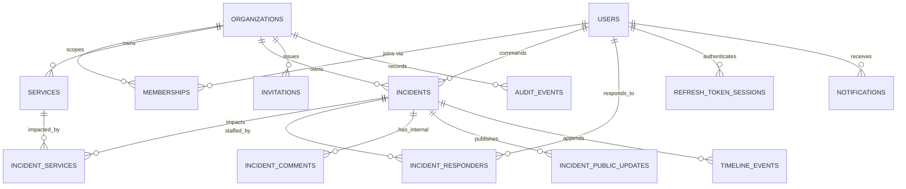

# SignalOps — Phase 0 · Data Model (ERD & Entity Specifications)

Status: DRAFT — awaiting approval

Conventions: UUID PKs · `timestamptz` UTC · enums as `TEXT + CHECK` · every tenant table
carries `organization_id UUID NOT NULL` · audit columns `created_at`, `updated_at` on all
mutable tables (via `BaseEntity`) · soft-delete = nullable `archived_at` where noted.

## 1. ERD

MVP tables only. `follow_up_tasks`, `attachments`, `maintenance_windows` are designed-for
(archival-safe, org-scoped) but deferred to Phase 3.

## 2. Entity Specifications

### organizations — owner module: `organizations`

- Fields: `id`, `name`, `slug` (unique, URL-key for public page), `created_at`.
- Constraints: `slug` unique, pattern `^[a-z0-9](?:[a-z0-9-]{1,38}[a-z0-9])$`.
- Deletion: hard delete out of MVP scope; no delete endpoint.
- Indexes: `uniq(slug)`.

### users — owner module: `users`

- Fields: `id`, `email`, `password_hash` (BCrypt cost 12), `full_name`, `is_active`,
  `created_at`. No avatar in MVP.
- Constraints: functional unique index on `lower(email)` (R20). Password hash never leaves
  the auth module; never serialized into any DTO.
- Deletion: deactivate (`is_active=false`), never hard-delete while memberships/audit exist.

### memberships — owner module: `organizations`

- Fields: `id`, `organization_id`, `user_id`, `role`
  (`OWNER|ADMIN|INCIDENT_COMMANDER|RESPONDER|VIEWER`), `status` (`ACTIVE|DISABLED`),
  timestamps.
- One role per membership (approved Phase 0 decision); a user may hold memberships
  in many organizations — that is the multi-org axis.
- Constraints: `uniq(organization_id, user_id)`.
- Indexes: `(user_id)` for "my orgs" lookup, `(organization_id, status)`.

### invitations

- Fields: `id`, `organization_id`, `email`, `role`, `token_hash` (SHA-256 of random token),
  `invited_by_user_id`, `expires_at`, `accepted_at` (null while pending), `revoked_at`,
  `created_at`.
- Raw token exists only inside the invite link (R21).
- Indexes: `(organization_id, accepted_at)`, `uniq(token_hash)`.

### services — owner module: `servicecatalog`

- Fields: `id`, `organization_id`, `name`, `slug`, `description`, `owning_team` (free-text
  label in MVP), `is_public` (appears on status page), `archived_at`, timestamps.
- Constraints: `uniq(organization_id, slug)`, CHECK on enum-ish fields as needed.
- Archiving: yes (`archived_at`), blocked while active incidents reference it (R18).
- Indexes: `(organization_id, archived_at)` partial `WHERE archived_at IS NULL`.

### incidents — owner module: `incidents`

- Fields: `id`, `organization_id`, `title`, `description`, `severity`, `status`,
  `commander_user_id` (nullable FK users), `resolution_summary` (set at resolve),
  `acknowledged_at`, `resolved_at`, `duration_seconds` (frozen on resolve), `resolver_user_id`,
  `archived_at`, `version BIGINT` (@Version, R12), `created_by_user_id`, timestamps.
- Constraints: CHECK severity/status domains; FKs `RESTRICT`.
- Lifecycle rules live in `Incident` aggregate methods, not services (state machine R7/R8).
- Archiving: yes (R6/R23). Hard delete: none.
- Indexes:
  - `(organization_id, created_at DESC)` — default list sort
  - `(organization_id, status)` partial `WHERE archived_at IS NULL` — active lists/dashboards
  - `(organization_id, severity)` partial `WHERE archived_at IS NULL` — critical tile
  - `(commander_user_id)`, `(organization_id, resolved_at)` for MTTR windows

### incident_services — join with tenant integrity

- Fields: `incident_id`, `service_id`, `organization_id`; PK `(incident_id, service_id)`.
- **Composite FK trick:** `services` and `incidents` get `UNIQUE(organization_id, id)`;
  this table's FKs reference `(organization_id, id)` — a row referencing services from a
  different org is *unrepresentable* at the DB level (hardens R11/R16).

### incident_responders

- Fields: `incident_id`, `user_id`, `assigned_by_user_id`, `assigned_at`;
  PK `(incident_id, user_id)`.
- Org validity of the user enforced by policy (R17) + integration tests.

### incident_comments — INTERNAL ONLY (R5/R14)

- Fields: `id`, `organization_id`, `incident_id`, `author_user_id`, `body`, timestamps.
- Append-only. Separate table from public updates so the public API physically cannot
  select internal data — separation by structure, not by WHERE clause discipline.

### incident_public_updates — PUBLIC ONLY (R14/R19)

- Fields: `id`, `organization_id`, `incident_id`, `author_user_id`, `message`,
  `status_at_publish`, `severity_at_publish`, `published_at`.
- Immutable snapshots; corrections are new rows (R19).
- An incident becomes publicly visible when it has ≥1 published update (drives status page).

### timeline_events — owner module: `timeline`

- Fields: `id`, `organization_id`, `incident_id`, `type` (enum:
  CREATED, STATUS_CHANGED, SEVERITY_CHANGED, COMMANDER_ASSIGNED, COMMANDER_REMOVED,
  RESPONDER_ASSIGNED, RESPONDER_REMOVED, COMMENT_ADDED, PUBLIC_UPDATE_PUBLISHED,
  RESOLVED, REOPENED, ARCHIVED), `actor_user_id` (nullable = system),
  `payload JSONB` (safe metadata only: e.g. `{from,to}` or `{severity}` — never raw bodies,
  never secrets), `occurred_at`.
- Append-only (R15-analog). Written in the same transaction as the mutation (R9).
- Indexes: `(incident_id, occurred_at DESC)`.

### audit_events — owner module: `audit`

- Fields: `id`, `organization_id`, `actor_user_id` (nullable = system), `action` (enum:
  USER_INVITED, MEMBER_ROLE_CHANGED, MEMBER_DISABLED, MEMBER_REMOVED, SERVICE_CREATED,
  SERVICE_UPDATED, SERVICE_ARCHIVED, ORG_SETTINGS_UPDATED, INCIDENT_EDITED,
  PASSWORD_CHANGED, AUTH_LOGIN_FAILED), `entity_type`, `entity_id`, `metadata JSONB`
  (safe summary only), `occurred_at`, optional `ip_hash` later.
- Append-only (R15): repository exposes `save` + finders; no update/delete methods ever;
  Phase 3 adds DB grants that revoke UPDATE/DELETE from the app role.
- Indexes: `(organization_id, occurred_at DESC)`, `(organization_id, action)`.

### refresh_token_sessions — owner module: `auth`

- Fields: `id`, `user_id`, `family_id` (UUID groups one login session), `token_hash`,
  `expires_at` (7 days), `revoked_at`, `replaced_by_token_id`, `user_agent_summary`,
  `created_at`.
- Rotation: each refresh mints a new row and revokes the old within the family;
  replaying a revoked token ⇒ revoke entire family (R22).
- Indexes: `(token_hash)` unique, `(family_id)`, cleanup job deletes expired > 30d (Phase 3).

### notifications — owner module: `notifications` (Phase 2)

- Fields: `id`, `organization_id`, `user_id`, `type`, `title`, `body`, `entity_type`,
  `entity_id`, `read_at`, `created_at`.
- Generated in-transaction from domain events; delivery channels added later without
  changing producers.
- Indexes: `(user_id, created_at DESC)`, partial `(user_id) WHERE read_at IS NULL`.

## 3. Ownership & Boundary Map

| Module | Owns tables | May read (via IDs / api interfaces) |
|---|---|---|
| auth | refresh_token_sessions, users(partial) | users |
| users | users | — |
| organizations | organizations, memberships, invitations | users(id,email,name) |
| servicecatalog | services | incidents(counts via events/api) |
| incidents | incidents, incident_services, incident_responders, incident_comments, incident_public_updates | services(ids), members(ids) |
| timeline | timeline_events | incidents(ids) |
| audit | audit_events | — |
| notifications | notifications | entity ids only |
| analytics | none (read-only queries over incidents) | read models |

## 4. Archiving / Deletion Matrix

| Entity | Soft archive | Hard delete | Notes |
|---|---|---|---|
| Organization | no | no (out of scope) | |
| User | deactivate | no | preserves audit/timeline actors |
| Membership | DISABLED | remove row | audit event written |
| Service | yes | no | blocked while active incidents (R18) |
| Incident | yes | no endpoint (R6) | |
| Comments/Public updates/Timeline/Audit | no | no | append-only by design |
